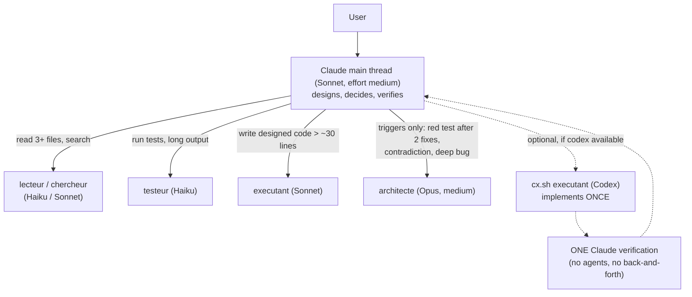

# Optimisation Pipeline IA

A measured Claude Code sub-agent pipeline, with an optional Codex (OpenAI) implementer: what helped, what did not, and the numbers.

## TL;DR

- **Sonnet alone is the right default.** On the bounded benches (T8-T10) every arm reaches the same quality (benches saturated), so only cost separates them. Adding Claude sub-agents costs about **1.85x** Sonnet alone on T10 with no quality gain.
- **Sub-agents pay off only on large, read-heavy work**, and Opus (`architecte`) only at well-defined triggers (a test still red after 2 fixes, a contradiction, a deep bug).
- **Codex as implementer + exactly one Claude verification** was the cheapest arm on a real, hard task (ENH-004): **0.53 $ of Claude spend vs 2.01 $ for Sonnet alone**, with the failing-test count at the pre-existing baseline (7). Codex alone is not reliable (state pollution, sometimes writes nothing).
- **The one clear quality gain from Codex**: a hard multi-file investigation, scored 5/5 vs 3/5 for Claude alone (n = 1 per arm).
- A "3x productivity" claim is **not** proven here. What is proven: Claude cost divided by about 4 at comparable test quality on one task.
- The whole thing works **with or without OpenAI**. Codex is a plus, never a dependency.

## Key results

Real-codebase test ("grandeur nature"): a FastAPI backend, baseline = **7 pre-existing failing tests**, ~540 passing. Cost = Claude spend only. Details: [`results/mesures_grandeur_nature_2026-10-16.md`](results/mesures_grandeur_nature_2026-10-16.md).

### ENH-004 (hard: LRU eviction, retention, paginated replay)

| Arm | Setup | Claude cost | Failing tests (baseline 7) |
|---|---|---|---|
| A | Sonnet alone | 2.01 $ | 19 |
| D7 | Sonnet + agents | 2.57 $ | 14 |
| F6 | Opus alone | 4.04 $ | 21 |
| G6 | Opus + agents | 3.44 $ | 9 |
| B4 | Codex alone | 0 $ | 14 |
| **E8** | **Codex implements + 1 Claude verification** | **0.53 $** | **7** |
| **E9** (replay of E8) | **Codex implements + 1 Claude verification** | **0.33 $** | **7** |

Note: 7 existing tests contradicted the plan on purpose, so a few extra red tests are not necessarily faults; the brief that scored best told the implementer to adapt contradicted tests (without weakening them) and list them.

### ENH-006 (medium: per-session limiter + batch)

| Arm | Setup | Claude cost | Failing tests |
|---|---|---|---|
| A | Sonnet alone | 0.64 $ | 8 |
| D | Sonnet + agents | 0.89 $ | 8 |
| B | Codex alone | 0 $ | 29 (its new tests pollute shared state) |
| E1 | Codex + 1 Claude verification | 0.41 $ | 8 |

### Bounded benches and the hard investigation

- **T8, T9, T10**: saturated (same score in every arm). Only cost separates them; on T10, agents cost about 1.85x Sonnet alone ([`results/mesures_t10_2026-10-16.md`](results/mesures_t10_2026-10-16.md)).
- **Hard multi-file bug investigation**: Claude alone 3/5; Codex analysis (`enqueteur`, high effort) then Claude verification 5/5; medium effort 4/5 ([`results/mesures_hard_bug.md`](results/mesures_hard_bug.md), [`results/RAPPORT_COMPARATIF_2026-10-14.md`](results/RAPPORT_COMPARATIF_2026-10-14.md)). This is the only net quality gain from Codex we measured.

## Architecture



ASCII version:

```
            Claude main thread (Sonnet)  -- designs, decides, verifies
   +--------------+------------+-------------+----------------------+
   |              |            |             |                      |
 lecteur/      testeur     executant     architecte           (optional) Codex
 chercheur     (Haiku)     (Sonnet)      (Opus, medium,       cx.sh executant ONCE
 (Haiku/Sonnet)                          triggers only)         -> ONE Claude check
```

Rules that came out of the measurements: one deliverable per agent; an agent never waits more than 5 minutes (prompt cache lifetime); no workaround to make a test pass (leave it red and escalate); a Codex result is never accepted as is.

## Install & use WITHOUT OpenAI

1. Copy the agents and hooks:
   ```bash
   mkdir -p ~/.claude/agents ~/.claude/hooks
   cp agents/*.md ~/.claude/agents/
   cp hooks/*.py ~/.claude/hooks/
   ```
2. Copy [`examples/CLAUDE.example.md`](examples/CLAUDE.example.md) to `~/.claude/CLAUDE.md` (or merge it into yours).
3. Optional: register the hooks in `~/.claude/settings.json` (see [`results/config-stable.md`](results/config-stable.md) for the exact keys; adapt the Python path):
   - `claude_md_taille.py` (UserPromptSubmit): warns when a project CLAUDE.md exceeds ~15 KB.
   - `pause_longue.py` (UserPromptSubmit): blocks the first message after an idle period of more than 1 hour when the context is large (the cache is gone; resending continues and pays).
   - `conso_5h.py` (status line): writes the 5-hour / 7-day usage to a JSON file (terminal only).
4. Agent files are in French (the author's working language); the instructions are plain and can be translated without changing behaviour. The agents (`lecteur`, `chercheur`, `executant`, `testeur`, `architecte`, plus on-demand reviewers `chasseur-erreurs`, `securite-web`, `seo`) set their own `model:` in the front matter.

**What to expect**: Sonnet alone is the cheapest on small and medium tasks. Agents add overhead (about 1.85x on T10); use them for large reading or parallel independent chunks, not by reflex. Call `architecte` only at the triggers listed in the example CLAUDE.md.

## WITH OpenAI / Codex

Codex is optional. Skip every Codex step if `codex` is missing, logged out, or out of quota.

1. Install the Codex CLI and log in (`npm i -g @openai/codex`, then `codex` once). On Windows with Git Bash, make sure Node and the `codex` shim are on `PATH` (or set `CX_NODE_DIR`).
2. Install the wrapper: `cp codex/cx.sh ~/bin/cx.sh && chmod +x ~/bin/cx.sh`.
3. Put the Codex discipline in `~/.codex/AGENTS.md` (start from [`codex/AGENTS.md.example`](codex/AGENTS.md.example)).
4. Edit the model names in `cx.sh` (or export `CX_M_*`) to the ones your account offers. The names in the script (`gpt-6-luna`, `gpt-6-sol`, `gpt-6-astra`) are the ones available on the author's account at measurement time.
5. Call it WITHOUT shell redirection: `cx.sh executant "<brief>" <project_dir>`; the output comes back in the tool result. Each call appends its token usage to `$CX_LOG`.

### Roles

| Role | Model tier / effort | Sandbox | Use |
|---|---|---|---|
| `lecteur` | luna, low | read-only | read files |
| `chercheur` | luna, low + `--search` | read-only | web research |
| `executant` | sol, low | workspace-write | write bounded, test-controlled code |
| `relecteur` | sol, medium | read-only | review |
| `architecte` | astra, high | read-only | hard opinion (sparingly: quota) |
| `analyste` | astra, medium | read-only | routine investigation / audit |
| `enqueteur` | astra, high | read-only | hard investigation (never xhigh) |
| `chasseur-erreurs`, `securite-web`, `seo` | sol, medium | read-only | reuse the Claude agent file as prompt |

### The E8 recipe (Codex implements, Claude verifies once)

The brief to Codex `executant` must contain:

1. The exact test command, run directly with the venv's interpreter (not through a wrapper script such as `bash pt.sh`, which crashed in Codex's sandbox).
2. "Adapt to the new contract the existing tests that the plan contradicts, **without weakening them**, and list them." (With "leave them red" instead: 20 failures, same score as Sonnet alone.)
3. "**A reply without any modified file is a failure.**" (Without this sentence, 1 run out of 2 wrote nothing.)

Then ONE Claude Sonnet verification, with no sub-agents and no round trip: run the full suite, read the diff, fix what Codex broke (typically test pollution). If still unsatisfied, Claude fixes alone or calls `architecte`; do not loop with Codex. Full rules: [`docs/EXECUTANT.md`](docs/EXECUTANT.md).

## Methodology

- Arms differ in model, sub-agents and whether Codex is used; same prompt, same base copy, same grader (the repo's own test suite for the real-codebase runs; an automatic grader or a /5 rubric for the benches).
- Metrics: Claude cost in dollars (from the CLI JSON), turns, duration, failing/passing tests, OpenAI 5-hour quota points (fresh probe before reading a gauge).
- Bounded benches T1-T10 check quality saturation; "grandeur nature" runs check a real codebase; one hard multi-file investigation scores 5 expected findings.
- Raw notes, in French, in [`results/`](results/): `mesures.md` (running log), `RAPPORT_COMPARATIF_2026-10-14.md`, `mesures_t8/t9/t10`, `mesures_gros_projet_2026-10-14.md`, `mesures_hard_bug.md`, `mesures_grandeur_nature_2026-10-16.md`, `config-stable.md`. Project names in these files were anonymised.

## Honest limitations

- **n = 1 or 2 per arm.** Run-to-run variance was not measured; differences of a few failing tests are within plausible noise.
- **One codebase** for the real-world runs (a single FastAPI backend, two tasks).
- Benches T8-T10 are saturated: they say nothing about quality differences, only cost.
- Model names, sandbox flags and the Git Bash / PowerShell wording in `cx.sh` are specific to one Windows machine and one OpenAI account at one point in time. Expect to adapt them.
- Codex alone was unreliable (state pollution; on ENH-004 a run wrote nothing). The good result needs the verification step.
- **The "3x productivity" claim is NOT proven.** What is proven: Claude cost divided by about 4 (0.53 $ vs 2.01 $) at equal test quality on one task.
- Quota figures (OpenAI points) are noisy and account-dependent.

## Repository structure

```
agents/     Claude Code sub-agent definitions (lecteur, chercheur, executant, testeur, architecte, reviewers)
hooks/      Claude Code hooks and status line (CLAUDE.md size, long-pause guard, usage gauge)
codex/      cx.sh wrapper (Codex roles) and AGENTS.md.example (Codex discipline)
docs/       EXECUTANT.md: rules for using Codex as implementer / reviewer
examples/   CLAUDE.example.md: minimal global CLAUDE.md
results/    measurements and reports (French)
```

## License

MIT, see [`LICENSE`](LICENSE).
