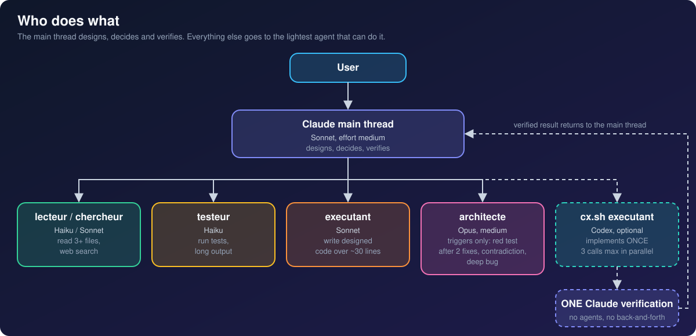

<div align="center">



# Optimisation Pipeline IA

**A Claude Code setup that delegates, saves tokens, and runs its own sessions — measured, not promised.**

[](LICENSE)


[Install](#install-in-30-seconds) ·
[What you get](#what-you-get) ·
[Autonomy](#autonomy) ·
[Token economy](#token-economy) ·
[Motion & creative](#motion--creative) ·
[Agents / Skills / Hooks](#agents--skills--hooks) ·
[Key results](#key-results) ·
[Limitations](#honest-limitations)

</div>

## Install in 30 seconds

```bash
git clone https://github.com/Nsapp44/optimisation-pipeline-ia
cd optimisation-pipeline-ia
claude
# then paste:  Read INSTALL.md and do it.
```

Claude diagnoses your setup, compares it with your existing `~/.claude`, makes a backup, copies the agents, skills and hooks, registers the hooks in `settings.json` itself (no JSON to paste by hand), checks the result, and tells you to restart. Full procedure, with a manual fallback: [`INSTALL.md`](INSTALL.md).

> Honest note: the procedure is written for Claude Code to execute. Try it on a throwaway profile first.

## What you get

Every line below is backed by a file in this repo.

| Without this setup | With it | Source |
|---|---|---|
| One model does everything, reads whole files | Reading, writing and testing go to cheap sub-agents; the main thread designs and verifies | [`AGENTS.md`](AGENTS.md) |
| `general-purpose` agents for everything | `lecteur` / `chercheur-web` / `executant` / `testeur`: a generic agent measured **5x** more expensive than `lecteur` / `chercheur` | [`results/mesures.md`](results/mesures.md) |
| Whole 4,000-line file read, then re-read every turn | Grep + line ranges: **233 k vs 625 k** tokens, **4.4x** less in equivalent cost | [`results/mesures.md`](results/mesures.md) |
| Opus for everything | Sonnet by default: **~45-50 % cheaper** at the same test score on two tasks | [`results/config-stable.md`](results/config-stable.md) |
| Hard task, Sonnet alone | Codex implements + one Claude verification: **0.53 $ vs 2.01 $** Claude spend, failing tests back at the baseline (7) | [`results/mesures_grandeur_nature_2026-10-16.md`](results/mesures_grandeur_nature_2026-10-16.md) |
| Long pause, then a message that rebuilds the whole cache | A hook blocks the first message after more than 1 h when the context is above 80 k tokens | [`hooks/pause_longue.py`](hooks/pause_longue.py) |
| Endless compaction loops | A hook detects 2 compactions in under 15 min and triggers a clean handover to a fresh session | [`hooks/boucle_compact.py`](hooks/boucle_compact.py) |
| `.env` overwritten, `rm -r` run blind | A `PreToolUse` hook refuses `.env` writes and asks before recursive deletes | [`hooks/protege_fichiers.py`](hooks/protege_fichiers.py) |

## Autonomy

The setup is built so a session keeps working without you at the keyboard.

- **Sessions that create their own sessions.** The `passation` skill (handover) checks that `SUIVI.md` is clean, **commits locally first** so nothing is lost, opens a fresh session with the brief "read `SUIVI.md` and continue at the exact next step", then offers to delete the old one. It needs the desktop app's session tools; an autonomous mode runs without a pop-up when the compaction-loop hook fires. See [`skills/passation/SKILL.md`](skills/passation/SKILL.md).
- **Request queue.** Each new request is added to a numbered "File des demandes" in `SUIVI.md` before being handled, so a burst of messages does not lose tasks.
- **`SUIVI.md` = current state only.** Rewritten (not appended) at every step: decisions in force, what did not work, exact next step. A hook warns above 8,000 bytes ([`hooks/suivi_taille.py`](hooks/suivi_taille.py)).
- **Autonomous work.** A blocked session does not wait: it notes the question in "Questions en attente" of `SUIVI.md`, takes the safest reversible option, carries on, and asks everything in one pop-up when you come back.
- **One active conversation per project folder.** The next one starts only after the previous one wrote `SUIVI.md` and made its local commit.
- **Guard rails.** Hooks cap the size of `SUIVI.md` and project `CLAUDE.md`, block the first message after a costly pause, and protect `.env` files and recursive deletes. Push stays on your explicit order.

Rules in full: [`claude/CLAUDE.md`](claude/CLAUDE.md).

## Token economy

Numbers come from the raw logs in [`results/`](results/) and [`docs/global/`](docs/global/). Calibration used: Pro plan, Opus-equivalent tokens; weights input 1, cache created 2, cache read 0.1, output 5, Sonnet 0.6, Haiku 0.2.

| Lever | Measured | Source |
|---|---|---|
| Sonnet instead of Opus (medium effort) | Same score (26/26 expression evaluator, 33/33 CSV reader); ~45-50 % cheaper (27-56 k vs 56-101 k on the first task) | [`config-stable.md`](results/config-stable.md) |
| Medium instead of high effort | Same result (26/26), about 50 % less reasoning; high is ~1.6x more expensive | [`config-stable.md`](results/config-stable.md), [`agents_delegation.md`](docs/global/agents_delegation.md) |
| An agent is not free | A new agent recreates ~20-30 k of cache at start-up; worth it only if it saves the main thread more than ~30 k | [`agents_delegation.md`](docs/global/agents_delegation.md) |
| Plugins and MCP servers | Fixed base of ~78 k tokens re-read at every message (tools ~39 k, MCP ~21 k, CLAUDE.md ~8 k, measured 11/10); unused plugins cost ~5 k per session | [`contexte_cache.md`](docs/global/contexte_cache.md), [`mesures.md`](results/mesures.md) |
| Short `CLAUDE.md` | Re-read every message; hook warns above 15,000 bytes for a project file | [`hooks/claude_md_taille.py`](hooks/claude_md_taille.py) |
| Compaction at 160,000 tokens | 130,000 looped (context restarts at ~110 k after compaction) | [`contexte_cache.md`](docs/global/contexte_cache.md) |
| Pause guard | Cache of the main thread lasts 1 h; 23 % of it was lost to pauses over 14 days on the author's machine | [`config-stable.md`](results/config-stable.md) |
| Agent never waits more than 5 min | Agent cache lasts 5 min; 22 % of agent cache (about 1.1 M) lost on one Qt project before the rule | [`config-stable.md`](results/config-stable.md) |
| Cut command output | A 10 KB Bash output adds ~30 % to the turn; output capped at 15,000 characters | [`mesures.md`](results/mesures.md), [`config-stable.md`](results/config-stable.md) |
| Targeted delegation | Haiku for mechanical reading and test runs, Sonnet for code already designed, Opus (`architecte`) only at defined triggers | [`AGENTS.md`](AGENTS.md) |

The 1 h agent-cache setting was tested and **not** adopted: it would have cost +2.6 M to save 1.1 M.

## Motion & creative

What the setup knows how to do, through its skills:

- **Scroll-driven product animation** from a rough Blender draft: scripted `bpy` model, image sequence plus pixel coordinates, then GSAP ScrollTrigger with canvas and HTML/SVG layers pinned by homography. Skill `blender-anim-web`.
- **Short-form video motion** (Shorts / TikTok style): skill `motion-tiktok`. The copy in this repo contains only its sound-design rules.
- **Pixel-level check** of a delivered screen against the approved mockup, text report only: `verif-pixel`.
- **Responsive check** at 375 / 768 / 1440 px before saying "done": `verif-responsive-web`.
- **Design guidelines** review: `web-design-guidelines`.

The production videos are **not** in this repository. In day-to-day use the setup produced a website, small web games and dozens of short videos.

## Agents / Skills / Hooks

Agents, skills and hooks are written in French; Claude reads them fine.

### Agents (`agents/`)

| Name | Role | Model |
|---|---|---|
| `lecteur` | Read-only: 3+ files or ~300 lines, folder exploration | Haiku |
| `testeur` | Runs tests, lint, builds, captures; reports; never edits | Haiku |
| `chercheur-web` | All web research (WebSearch / WebFetch) | Sonnet |
| `executant` | Writes code already designed, minimal diff | Sonnet |
| `executant-ui` | Writes web / Qt interface code, design skills preloaded | Sonnet |
| `chasseur-erreurs` | On request: hunts silent errors, read-only | Sonnet |
| `securite-web` | On request: secrets, XSS, CSP review before release, read-only | Sonnet |
| `seo` | On request: technical SEO audit, read-only | Sonnet |
| `architecte` | The only Opus agent: stuck test, workaround temptation, contradictions | Opus |

### Skills (`skills/`)

| Name | Role | Model |
|---|---|---|
| `passation` | Clean handover to a fresh session (commit, brief, cleanup) | session model |
| `menage-claude-md` | Shrink a project `CLAUDE.md` under ~15 KB without loss | session model |
| `blender-anim-web` | Blender draft to scroll animation (GSAP ScrollTrigger) | session model |
| `motion-tiktok` | Short-form motion rules (sound design in this copy) | session model |
| `verif-pixel` | Pixel diff of a capture against a mockup | session model |
| `verif-responsive-web` | Responsive check at three widths | session model |
| `web-design-guidelines` | Web interface guidelines review (author field: vercel) | session model |

### Hooks (`hooks/`)

| Name | Event | Role |
|---|---|---|
| `pause_longue.py` | UserPromptSubmit | Blocks the first message after more than 1 h idle when context is large |
| `boucle_compact.py` | UserPromptSubmit | Detects a compaction loop, asks for a handover |
| `claude_md_taille.py` | UserPromptSubmit | Warns when a project `CLAUDE.md` is too big |
| `suivi_taille.py` | UserPromptSubmit | Warns once per conversation when `SUIVI.md` is too big |
| `protege_fichiers.py` | PreToolUse | Refuses `.env` writes, asks before recursive deletes |
| `conso_5h.py` | Status line | Writes 5-hour / 7-day usage to a JSON file |

## Architecture

<div align="center">

</div>

<div align="center">

</div>

Rules that came out of the measurements: one deliverable per agent; an agent never waits more than 5 minutes (prompt cache lifetime); no workaround to make a test pass (leave it red and escalate); a Codex result is never accepted as is.

- **One `AGENTS.md`, plus `CLAUDE.md`** that imports it (`@AGENTS.md`), so Claude Code and Codex share the same rules.
- **At most 3 Codex calls in parallel**, enforced by `CX_MAX_PARALLEL` in `cx.sh`.

## Key results

Real-codebase test ("grandeur nature"): a FastAPI backend, baseline = **7 pre-existing failing tests**, ~540 passing. Cost = Claude spend only. Details: [`results/mesures_grandeur_nature_2026-10-16.md`](results/mesures_grandeur_nature_2026-10-16.md).

<div align="center">

</div>

### ENH-004 (hard: LRU eviction, retention, paginated replay)

| Arm | Setup | Claude cost | Failing tests (baseline 7) |
|---|---|---|---|
| A | Sonnet alone | 2.01 $ | 19 |
| D7 | Sonnet + agents | 2.57 $ | 14 |
| F6 | Opus alone | 4.04 $ | 21 |
| G6 | Opus + agents | 3.44 $ | 9 |
| B4 | Codex alone | 0 $ | 14 |
| **E8** | **Codex implements + 1 Claude verification** | **0.53 $** | **7** |
| **E9** (replay of E8) | **Codex implements + 1 Claude verification** | **0.33 $** | **7** |

Note: 7 existing tests contradicted the plan on purpose, so a few extra red tests are not necessarily faults.

### ENH-006 (medium: per-session limiter + batch)

| Arm | Setup | Claude cost | Failing tests |
|---|---|---|---|
| A | Sonnet alone | 0.64 $ | 8 |
| D | Sonnet + agents | 0.89 $ | 8 |
| B | Codex alone | 0 $ | 29 (its new tests pollute shared state) |
| E1 | Codex + 1 Claude verification | 0.41 $ | 8 |

<details>
<summary><b>Bounded benches (T8-T10) and the hard investigation</b></summary>

- **T8, T9, T10**: saturated (same score in every arm). Only cost separates them; on T10, agents cost about 1.85x Sonnet alone ([`results/mesures_t10_2026-10-16.md`](results/mesures_t10_2026-10-16.md)).
- **Hard multi-file bug investigation**: Claude alone about 3/5; Codex analysis then Claude verification up to 5/5 ([`results/mesures_hard_bug.md`](results/mesures_hard_bug.md), [`results/RAPPORT_COMPARATIF_2026-10-14.md`](results/RAPPORT_COMPARATIF_2026-10-14.md)). The only net quality gain from Codex we measured.

</details>

**Takeaways.** Sonnet alone is the right default. Sub-agents pay off only on large, read-heavy work. Codex alone is not reliable; the good result needs the verification step.

## Methodology

- Arms differ in model, sub-agents and whether Codex is used; same prompt, same base copy, same grader (the repo's own test suite for the real-codebase runs; an automatic grader or a /5 rubric for the benches).
- Metrics: Claude cost in dollars (from the CLI JSON), turns, duration, failing/passing tests, OpenAI 5-hour quota points.
- Bounded benches T1-T10 check quality saturation; "grandeur nature" runs check a real codebase; one hard multi-file investigation scores 5 expected findings.

<details>
<summary><b>Raw measurement files (French, project names anonymised)</b></summary>

In [`results/`](results/): `mesures.md` (running log), `RAPPORT_COMPARATIF_2026-10-14.md`, `mesures_t8/t9/t10`, `mesures_gros_projet_2026-10-14.md`, `mesures_hard_bug.md`, `mesures_grandeur_nature_2026-10-16.md`, `config-stable.md`. A PDF summary is in [`Rapport_tests_pipeline.pdf`](Rapport_tests_pipeline.pdf).

</details>

## Codex (optional)

Codex implements, Claude verifies once. Skip every Codex step if `codex` is missing, logged out, or out of quota. Wrapper: [`codex/cx.sh`](codex/cx.sh) (adapt the model names to your account). Roles and the E8 recipe are in [`docs/EXECUTANT.md`](docs/EXECUTANT.md) and [`AGENTS.md`](AGENTS.md). Short version of the recipe: give the exact test command; tell Codex to adapt contradicted tests without weakening them and list them; state that a reply with no modified file is a failure; then ONE Claude verification (full suite, read the diff, fix test pollution).

 Claude designs, verifies, orchestrates.  Codex implements bounded, test-controlled code.

## Honest limitations

> [!WARNING]
> - **n = 1 or 2 per arm.** Run-to-run variance was not measured; differences of a few failing tests are within plausible noise.
> - **One codebase** for the real-world runs (a single FastAPI backend, two tasks).
> - Benches T8-T10 are saturated: they say nothing about quality differences, only cost.
> - **The install prompt has not been tested end to end on a clean profile.** Try it on a throwaway profile first.
> - Token figures come from one author's machine and plan (Pro, Opus-equivalent calibration); yours will differ.
> - `passation` relies on the desktop app's session tools; elsewhere, use the manual steps.
> - Model names, sandbox flags and the Git Bash / PowerShell wording in `cx.sh` are specific to one Windows machine and one OpenAI account at one point in time.
> - Codex alone was unreliable (state pollution; on ENH-004 a run wrote nothing).
> - **The "3x productivity" claim is NOT proven.** What is proven: Claude cost divided by about 4 (0.53 $ vs 2.01 $) at equal test quality on one task.
> - Quota figures (OpenAI points) are noisy and account-dependent.

## Repository structure

```
INSTALL.md  Install procedure for Claude Code to execute (+ manual fallback)
AGENTS.md   Single shared rules file (Claude Code and Codex)
CLAUDE.md   Imports AGENTS.md (@AGENTS.md)
agents/     9 Claude Code sub-agent definitions (lecteur, testeur, executant, architecte, reviewers...)
skills/     7 skills (passation, blender-anim-web, verif-pixel, verif-responsive-web, ...)
hooks/      6 hooks / status line (pause guard, compaction loop, size warnings, .env protection, usage gauge)
claude/     CLAUDE.md (global rules) and settings.modele.json (settings template)
codex/      cx.sh wrapper (Codex roles, max 3 parallel via CX_MAX_PARALLEL)
results/    measurements and reports (French)
docs/       EXECUTANT.md and docs/global/ (delegation, cache, video/motion, routines, mockups)
assets/     README visuals (SVG): hero, pipeline-flow, architecture, dashboard, banner, cost-chart, logos
```

## License

MIT, see [`LICENSE`](LICENSE).

## Thanks

Ideas and inspiration from [obra/superpowers](https://github.com/obra/superpowers) and [greensock/gsap-skills](https://github.com/greensock/gsap-skills) (MIT). No text copied.
